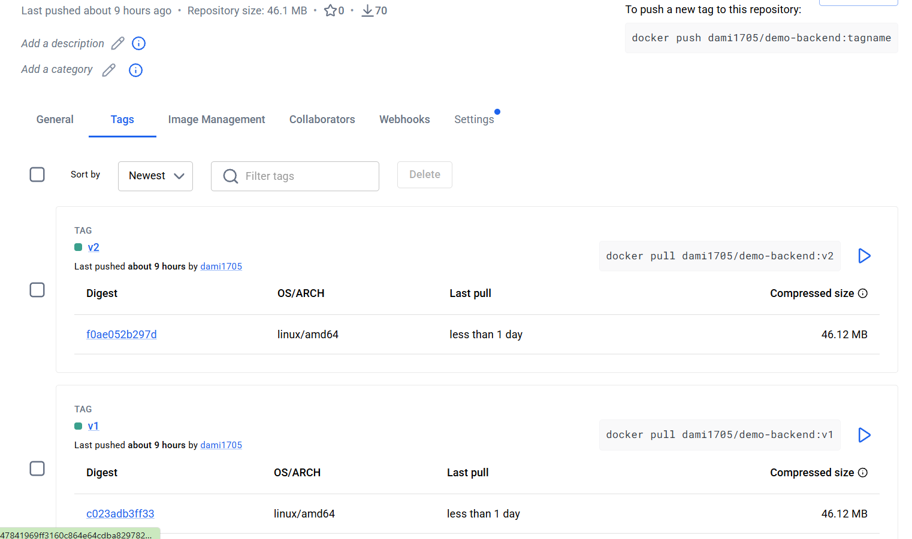
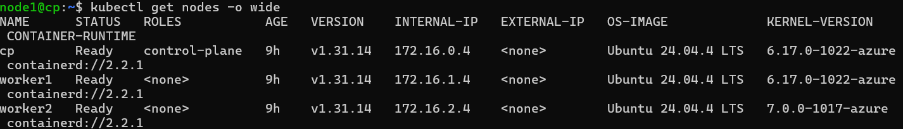
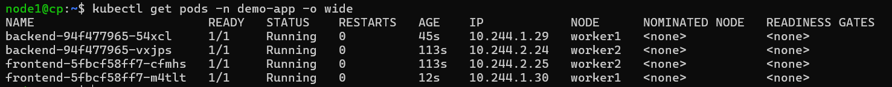
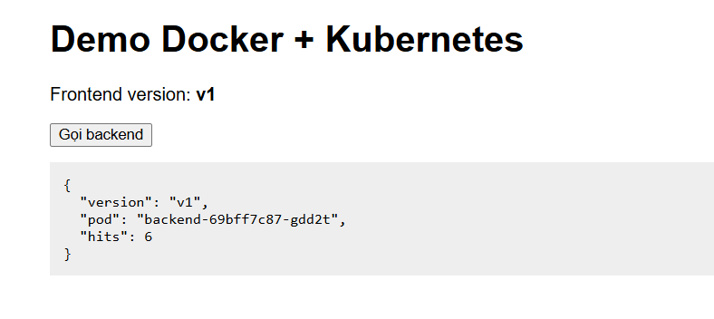
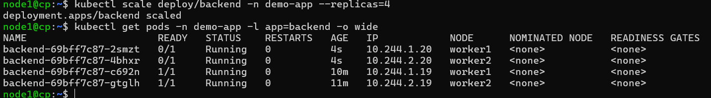
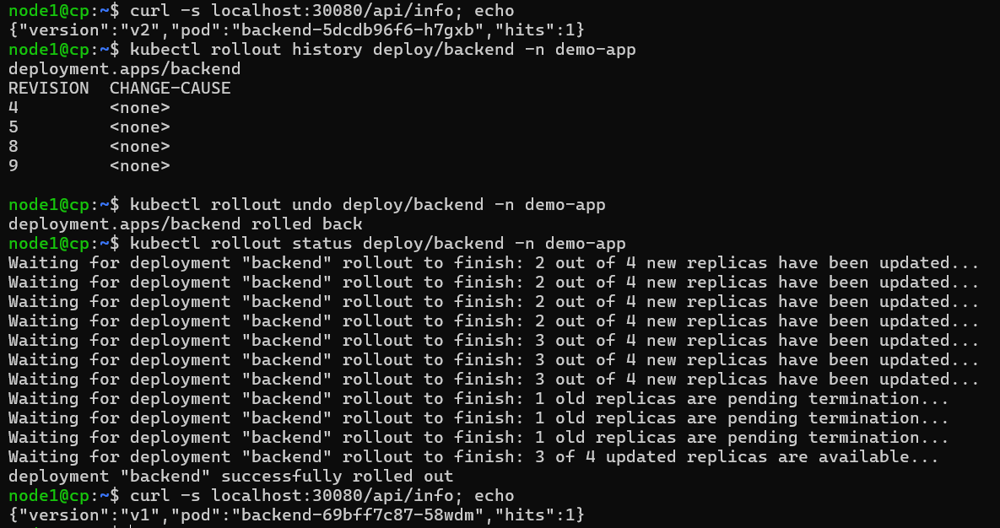
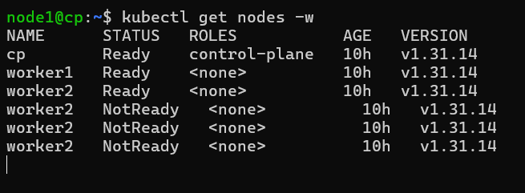
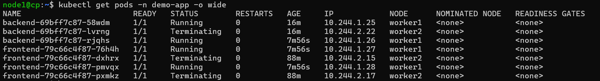
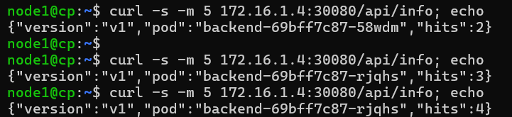

# Báo cáo giữa kỳ CKA 2026

Nhóm: ... | Thành viên (5): ... | Repo: ...

Bản đầy đủ để nộp: [Bao-cao.pdf](Bao-cao.pdf). Slide: [Thuyet-trinh.pptx](Thuyet-trinh.pptx).

## 1. Sơ đồ cluster
Trình duyệt → Service frontend (NodePort 30080) → Pod frontend x2 → Service backend (ClusterIP 3000) → Pod backend x2.
Các Pod dàn đều trên worker1, worker2. Control plane (cp) chạy API server, etcd. CNI: flannel.

## 2. Đóng gói Docker
Image: `dami1705/demo-backend` (v1, v2), `dami1705/demo-frontend` (v1).

## 3. Dựng cluster
3 VM Azure (cp, worker1, worker2), kubeadm v1.31, CNI flannel.

## 4. Triển khai
Namespace `demo-app`, mỗi Deployment 2 replicas, Pod trải trên 2 worker.

## 5. Vận hành
### 5.1 Scale lên 4 replicas

### 5.2 Cập nhật v2 và rollback v1

### 5.3 Tắt một worker

Diễn biến: node NotReady sau khoảng 40 giây; Service loại Pod của node đó nên ứng dụng vẫn chạy qua worker1; sau khoảng 5 phút Pod bị xóa và được tạo lại trên worker1; khi bật lại node, Pod không tự chuyển ngược về.

## 6. Khó khăn gặp phải
- Hạn mức Azure for Students: dùng lại VM sẵn có, mở cổng 30080 trên NSG.
- Thiếu `conntrack` khi chạy kubeadm trên Ubuntu 24.04.
- `kubectl` không chạy với user thường: sao chép `admin.conf` vào `~/.kube/config`.
- Xung đột priority NSG với rule HTTP có sẵn.
- Pod dồn về một worker sau khi giảm replicas: xóa Pod để scheduler dàn lại.
- Image trên Docker Hub phải public để cluster pull được.
